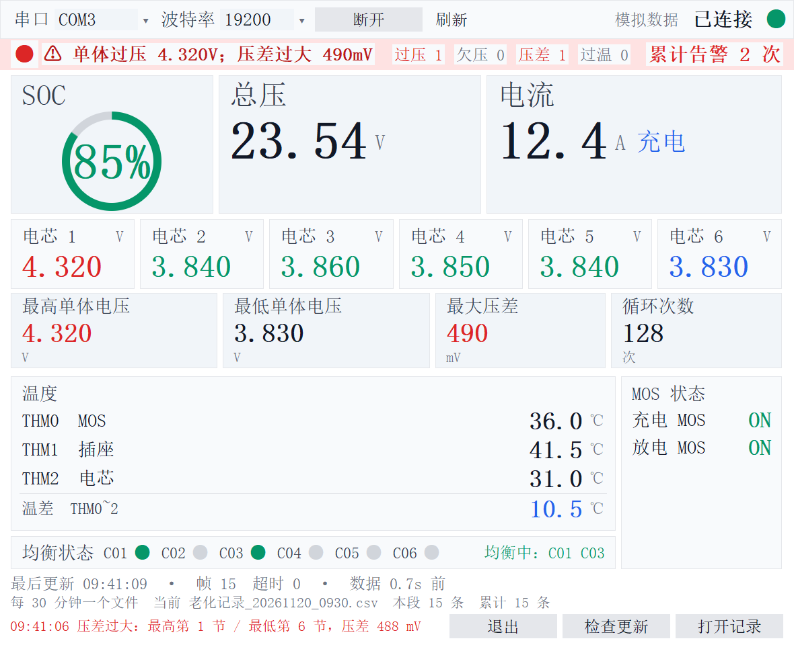

# 电池老化测试上位机（BMS Aging Host）

用于 6 串电池老化测试的轻量级 Windows 上位机，按原厂 `BmsStudioV3Qt` 的串口协议重写，
只保留老化测试需要的显示、告警和记录功能。纯 Python 标准库 + tkinter 实现，无需安装第三方库。



## 功能

- 6 节电芯电压（V）：最高一节红色、最低一节蓝色、其余绿色
- 最高单体电压 / 最低单体电压 / 最大压差 / 循环次数
- THM0 = MOS 温度、THM1 = 插座温度、THM2 = 电芯温度，以及三路温差
- SOC 圆形进度环：80%~100% 绿色、30%~80% 深蓝色、<30% 黄色、<10% 红色
- 充电 / 放电状态（按电流正负判断，放电红色、充电蓝色）
- **均衡状态**：C01~C06 六个指示点（绿色 = 该节正在均衡），并汇总“均衡中：C01 C03”
- MOS 状态（充电 MOS / 放电 MOS）
- 告警条：单体过压、欠压、压差过大、过温；可选提示音，累计告警条数
- 逐帧记录：每一帧写一条 CSV，每 30 分钟自动分文件（UTF-8 BOM，Excel 可直接打开）
- 最小化到系统托盘后台运行；单实例
- 窗口可自由缩放，字号随窗口自动调整，过小时出现滚动条
- 内置在线更新：从清单地址检查新版本、下载、校验 SHA256 并自动替换重启

## 直接使用（推荐）

1. 打开右侧 **Releases**，下载最新 `BmsAgingHost.exe`（单文件版）；
2. 双击运行，首次会解压到 `%LOCALAPPDATA%\BmsAgingHost\app`；
3. 选择串口和波特率（默认 19200），点“连接”。

单文件版与文件夹版（`BmsAgingHost_portable.zip`，含 `runtime\`）功能相同。

## 源码运行

需要 Windows 10/11 + Python 3.10（tkinter 自带）：

```bat
python app.py            :: 正常启动
python app.py --demo     :: 无硬件时模拟数据
python app.py --port COM6 --baud 19200
```

没有 Python 环境时，解压便携包后双击 `启动上位机.bat`（使用包内 `runtime\pythonw.exe`）。

## 配置（config.json）

| 键 | 默认 | 说明 |
|---|---|---|
| `port` / `baud` | "" / 19200 | 上次使用的串口和波特率 |
| `cell_count` | 6 | 电芯数量 |
| `cycle_s` | 2.0 | 轮询周期（秒） |
| `timeout_ms` | 800 | 单条应答超时 |
| `record_window_min` | 30 | 记录文件分段分钟数 |
| `output_dir` | 记录 | 记录目录（相对程序目录） |
| `start_minimized` | false | 启动即最小化到托盘 |
| `update.manifest_url` | "" | 在线更新清单地址 |
| `alarms.cell_max_v` | 4.3 | 单体过压阈值（V） |
| `alarms.cell_min_v` | 2.5 | 单体欠压阈值（V） |
| `alarms.delta_mv` | 200 | 最大压差阈值（mV） |
| `alarms.temp_c` | 75 | 过温报警阈值（℃） |
| `alarms.temp_warn_c` | 65 | 温度预警（数字变红，不报警） |
| `alarms.temp_delta_warn_c` | 20 | 温差预警（数字变红） |
| `alarms.beep` | true | 告警提示音 |

## 数据记录

采集到的**每一帧**都会写入 CSV，按 30 分钟分段：

```
记录\老化记录_YYYYMMDD_HHMM.csv
```

列为：时间、警报状态、SOC、三路温度、温差、电芯 1~6 电压、电流、最高/最低单体、充放电状态。
告警另存 `告警记录_YYYYMMDD.csv`（触发/恢复两地平）。

## 在线更新

程序底部“检查更新”会读取 `config.json` → `update.manifest_url` 指向的 JSON：

```json
{
  "version": "2026.11.21.1",
  "notes": "更新说明",
  "exe_url": "https://github.com/USER/REPO/releases/download/v2026.11.21.1/BmsAgingHost.exe",
  "exe_sha256": "新 exe 的 SHA256"
}
```

`version` 大于程序内置版本才会提示；下载后校验 SHA256，校验通过后退出并由后台脚本
替换 EXE、重新启动。详细步骤见 [GitHub发布说明书.md](GitHub发布说明书.md)（同目录也有
`GitHub上传说明书.docx` / `.pdf`）。

> 第一次上传仓库时，`update.json` 的 `version` 建议先填当前版本 `2026.11.20.1`，
> 等真正发布新 EXE 后再改大；否则旧版会提示更新但下载链接是占位地址。

命令行只检查不下载：

```bat
BmsAgingHost.exe --check-update https://raw.githubusercontent.com/USER/REPO/main/update.json
```

## 通信协议

帧格式：`7B | LEN | DATA | CRC8 | 7D`，LEN = CMD + 负载长度，CRC8 多项式 `0x2A`、初值 0、
覆盖 `LEN + DATA`。请求为 `7B 01 CMD CRC 7D`。

| 命令 | 内容 | 说明 |
|---|---|---|
| 0x20 | 版本信息 | 字节 0-2 硬件、3-5 软件、6-8 协议 |
| 0x30 | 单体电压 | 每节 u16，mV，大端 |
| 0x31 | 电芯温度 | 字节 0-1，i16，0.1 ℃ |
| 0x32 | 其他温度 | 0-1 MOS、16-17 插座、18-19 负极、28-29 PCB |
| 0x33 | 系统信息 | 2-3 串数、4-5 温度数、50-51 循环次数 |
| 0x50 | 实时状态 | 0-1 总压(0.1V)、2-3 电流(0.1A)、4-5 SOC、6-7 SOH、8-15 最高/最低及序号、30-33 总压(0.001V)、34-37 总电流、38 充放电、39 MOS 使能、40 充电器/负载、41 bit0~5 均衡 C01~C06、49-62 告警 |

程序只发送上述只读查询，不写任何参数。原厂程序与本程序**不能同时占用同一个串口**。

## 目录结构

```
app.py                     主程序（界面、采集、告警、记录、托盘、更新入口）
bms_protocol.py            协议帧、CRC8、各命令解码
win_serial.py              Win32 串口（ctypes，无需 pyserial）
tray_icon.py               托盘图标与菜单
updater.py                 在线更新（清单、下载、SHA256、替换重启）
config.json                配置
app.ico                    图标
tests/                     协议/假串口/CSV 回归测试
使用说明.md                 中文使用说明
GitHub发布说明书.md         上传 GitHub、发布 Release、配置在线更新
update.json                在线更新清单模板
build/Program.cs           单文件 EXE 启动器源码（解压内嵌运行环境并启动 Python）
```

## 构建单文件 EXE

`电池老化上位机.exe` 是一个 C# 启动器，内嵌 `runtime` + 源码的 zip：

1. 用 `build/Program.cs` 编译（`csc /target:winexe /resource:payload.zip,payload.zip ...`）；
2. 启动器首次运行把 payload 解压到 `%LOCALAPPDATA%\BmsAgingHost\app`，再启动 `runtime\pythonw.exe app.py`；
3. 修改程序版本时，同时更新 `Program.cs` 的 `Version` 和 `app.py` 的 `APP_VERSION`。

## 说明

- 本程序按原厂协议重写，仅用于自家电池老化测试；请确认串口接线与波特率正确。
- 仓库不包含 `runtime\`（约 37 MB）和编译好的 exe，Windows 运行环境通过 Releases 分发。
- 记录文件可能包含测试数据，默认已在 `.gitignore` 中排除。
