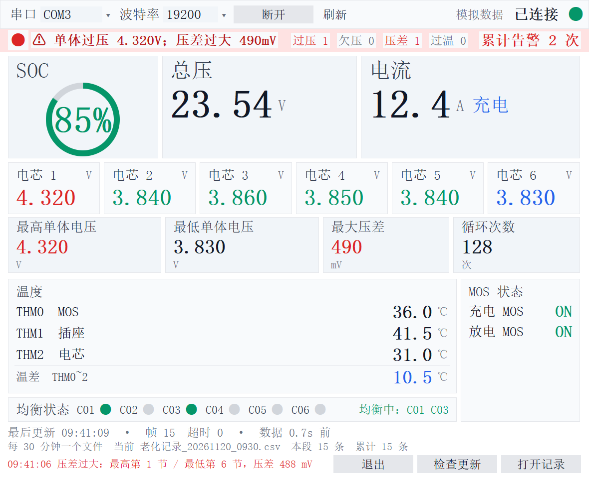

# 电池老化测试上位机（精简版）

原来的 `BmsStudioV3Qt.exe` 是编译后的程序，界面无法直接改。我按它的通信协议
（0x7B/0x7D 帧、CRC8）重写了一个**只保留老化测试所需内容**的上位机。

## 两种用法

- **单文件版**：直接双击 **`电池老化上位机.exe`**。首次运行会把运行环境解压到
  `%LOCALAPPDATA%\BmsAgingHost\app`（约 37 MB），之后启动很快；记录和配置都在该目录下
  （窗口里点“打开记录”可直接打开）。
- **文件夹版**：双击 `启动上位机.bat`（需要同目录的 `runtime` 文件夹），免安装、可整体拷贝。

两种方式功能完全一样，任选一种即可。

## 功能

* 6 节电芯电压（V）：正常绿色，最高的一节显示红色，最低的一节显示蓝色
* 最高单体电压 / 最低单体电压 / 最大压差
* THM0 = MOS 温度、THM1 = 插座温度、THM2 = 电芯温度，并显示三路之间的**温差**
* 循环次数
* SOC（荷电状态）：0~100 的**圆形进度环**，按百分比填充（50% 半圈、80% 满大半圈）；80%~100% 绿色，30%~80% 深蓝色，低于 30% 黄色，低于 10% 红色
* MOS 状态（充电 MOS / 放电 MOS）
* **均衡状态**：C01~C06 六个指示点（绿色=该节正在均衡），右侧显示“均衡中：C01 C03”或“未均衡/未记录”
* 串口选择、波特率选择、连接状态
* **告警条**：超压 / 欠压 / 压差 / 过温，带累计告警条数
* 每一帧数据都保存，每 30 分钟自动分成一个 CSV 文件，可缩到托盘后台运行
* 字体随窗口大小自动缩放（拉大窗口字变大，缩小窗口字变小）
* 窗口可自由拖动缩放（最小 1000×700）；缩到放不下时右侧出现滚动条，放大时自动铺满



---

## 1. 使用方法

1. 电池通过 USB 转串口（CH340 等）连电脑，装好驱动；
2. 双击 **`电池老化上位机.exe`**（或 `启动上位机.bat`）；
3. 在顶部选择 **串口** 和 **波特率**（默认 19200），点 **连接**；
4. 连接成功后指示灯变绿，开始每 2 秒刷新。

关闭窗口 = 缩到右下角托盘继续采集；托盘图标双击打开窗口，右键可“退出”。
想开机就后台运行，用 **`后台运行.bat`**，或把它的快捷方式放进
`%APPDATA%\Microsoft\Windows\Start Menu\Programs\Startup`。

> 串口是独占的：本程序和原来的 BmsStudioV3Qt **不能同时连接同一个 COM 口**，
> 用哪个就关掉另一个。

---

## 2. 告警条（过压 / 欠压 / 压差 / 过温）

界面第二行是常驻告警条，正常时绿色显示“运行正常，暂无告警”。以下任一条件成立时
变红，显示当前告警项和数值，并发出提示音：

| 条件 | 默认阈值 |
|---|---|
| 单体过压 | 任一节 > 4.300 V |
| 单体欠压 | 任一节 < 2.500 V |
| 压差过大 | 最高 − 最低 > 200 mV |
| 温度过高 | THM0 / THM1 / THM2 任一 > 75 ℃ |

* **累计告警条数**显示在告警条右侧；每次从“正常”变成“超限”计 1 条；
* 四个分类各有一个累计计数（过压 / 欠压 / 压差 / 过温）；
* 每条告警同时写入 `记录\告警记录_YYYYMMDD.csv`：
  时间、告警类型、触发/恢复、触发值、阈值、详细信息、持续秒；
* 每次重新“连接”会清零计数，重新开始统计；
* 阈值和提示音在 `config.json` 的 `alarms` 里改：

```json
"alarms": {
  "cell_max_v": 4.3,
  "cell_min_v": 2.5,
  "delta_mv": 200,
  "temp_c": 75,
  "temp_warn_c": 65,
  "beep": true
}
```

> 温度判断取三路温度里最高的那一路，所以 MOS 或插座过热也会报警。
>
> 另外：温度 **超过 65 ℃** 时温度数字会先变**红色**（预警），**超过 75 ℃** 才进入告警条和告警记录。
>
> 温差 **超过 20 ℃** 时，温差数字变**红色**（阈值 `temp_delta_warn_c` 可改）。

---

## 3. 数据记录（逐帧，每 30 分钟一个文件）

采集到的**每一帧数据都会保存**，并按 30 分钟自动分段成独立文件：

```
记录\老化记录_YYYYMMDD_HHMM.csv      （UTF-8 BOM，Excel 直接打开）
```

例如 `老化记录_20261118_1730.csv` 保存 17:30–17:59 之间的所有帧；到 18:00 自动新建
`老化记录_20261118_1800.csv`，后台运行时也一样。

| 列 | 说明 |
|---|---|
| 时间 | 本地时间，精确到秒 |
| 警报状态 | 当前告警项（过压/欠压/压差/过温），无告警写“正常” |
| SOC(%) | 荷电状态 |
| THM0_MOS / THM1_插座 / THM2_电芯 (℃) | 三路温度 |
| 温差(℃) | 三路温度的最大值 − 最小值 |
| 电芯1..6(V) | 每节单体电压 |
| 电流(A) | 实时电流 |
| 最高单体(V) / 最低单体(V) | 当帧最高、最低单体电压 |
| 充放电状态 | 按电流判断：电流为负=放电（红色），为正=充电（蓝色），接近 0=静置 |

窗口底部显示当前文件名、本段条数和累计条数；缩到托盘后照常逐帧记录。

分段长度在 `config.json` 里改（`record_window_min` 默认 30 分钟）。

---

## 4. 移植到其他电脑

整个文件夹复制过去即可，**不需要安装 Python**：

* `runtime\` 是随程序带的 Python 3.10（Windows x64，含 Tk 界面库），约 37 MB；
* 目标电脑只需要装好串口驱动（CH340/CP210x 等）；
* 记录写在程序目录下的 `记录\`，不依赖固定盘符；
* 第一次连接会自动记住串口和波特率（写入 `config.json`）。

如果目标电脑是 32 位系统，把 `runtime` 换成 32 位 Python 即可，程序本身是纯标准库。

---

## 5. 在线更新

窗口底部有 **“检查更新”** 按钮。点击后会从 `config.json` 里的
`update.manifest_url` 拉取一个 JSON 清单；发现新版本会显示版本号和更新说明，
确认后自动下载、校验 SHA256、退出并替换 EXE、重新启动。

### 5.1 准备更新清单

把下面这个 JSON 放到任意 HTTP 地址（公司服务器、对象存储、GitHub Releases 等）：

```json
{
  "version": "2026.11.20.1",
  "notes": "1. 修复 SOC 圆环\n2. 增加在线更新功能",
  "exe_url": "https://your-server/bms/电池老化上位机.exe",
  "exe_sha256": "新 exe 的 SHA256"
}
```

- `version` 必须大于程序内置版本号（当前 `2026.11.20.1`）才会提示更新；
- `exe_url` 是新 EXE 的直链；
- `exe_sha256` 可用 `certutil -hashfile 电池老化上位机.exe SHA256` 生成；
- 本目录下的 `update_manifest.example.json` 是模板。

### 5.2 配置清单地址

```json
"update": {
  "manifest_url": "https://your-server/bms/update.json",
  "timeout_s": 15
}
```

### 5.3 说明

- **仅单文件 EXE 支持自动替换**；文件夹版点击更新会提示手动下载新版；
- 更新时程序会退出，由后台脚本等待进程结束后覆盖 EXE 并重新启动；
- 建议使用 HTTPS；SHA256 不匹配会拒绝更新；
- 没有配置 `manifest_url` 时，点击按钮会提示先配置；
- 可用命令行自检清单：`电池老化上位机.exe --check-update https://your-server/bms/update.json`。

---

## 6. 通信协议（已验证）

帧格式与 BmsStudioV3Qt 3.8.13 Qt030 完全一致：

```
7B | LEN | DATA(LEN 字节) | CRC8 | 7D
LEN = CMD + 负载长度
CRC8: 多项式 0x2A，初值 0，覆盖 LEN + DATA
请求: 7B 01 CMD CRC 7D
```

| 命令 | 含义 | 用到的字段（负载偏移，big-endian） |
|---|---|---|
| 0x20 | 版本 | 0-2 软件、3-5 硬件、6-8 协议 |
| 0x30 | 单体电压 | 每 2 字节一节（mV），最多 14 节 |
| 0x31 | 电芯温度 THM2 | 0-1 / 2-3（固件写同值），有符号 ℃ |
| 0x32 | MOS/插座温度 | 0-1 MOS(THM0)、16-17 插座(THM1)、18-19 负极、28-29 PCB |
| 0x33 | 系统信息 | 2-3 串数、4-5 温度数、50-51 循环次数 |
| 0x50 | 实时状态 | 0-1 总压(0.1V)、2-3 电流(0.1A)、4-5 SOC、6-7 SOH、8-15 最高/最低及序号、30-33 总压(0.001V)、34-37 总电流、38 充放电、39 MOS 使能、40 充电器/负载、41 bit0~5 均衡 C01~C06、49-62 告警 |

协议是用官方程序自带的解码模块逐字节比对出来的（用 0x20 已知应答校验过 CRC），
`tests\test_app.py` 里还有假串口回归测试。

---

## 7. 常见问题

**连不上 / 打开串口失败**
串口被占用（官方上位机还开着、串口助手没关），或驱动没装。点 **刷新** 看端口是否出现。

**连上但一直没数据**
确认波特率 19200；换一根 USB 线/口；看“帧/超时”计数是否在涨。若一直超时，
说明 BMS 没回该命令，先用官方上位机确认能通信。

**告警一直响 / 想静音**
`config.json` → `alarms.beep` 改成 `false`；或调高对应阈值。

**想改保存间隔**
`config.json` → `record_window_min`（分钟），改完重启程序。

**想只记录不显示**
用 `后台运行.bat`，窗口缩在托盘，记录照常。

**和官方上位机的关系**
两者协议相同但**不能同时占用同一个串口**。本程序只发官方用过的只读查询
（0x20/0x30/0x31/0x32/0x33/0x50），不写任何参数。

---

## 8. 文件清单

| 文件 | 作用 |
|---|---|
| `app.py` | 主程序（界面、采集、告警、逐帧记录、托盘） |
| `电池老化上位机.exe` | 单文件版（内嵌运行环境，首次运行自动解压） |
| `bms_protocol.py` | 帧/CRC/各命令解码 |
| `win_serial.py` | Win32 串口（无需 pyserial） |
| `updater.py` | 在线更新（清单/下载/SHA256/替换重启） |
| `update_manifest.example.json` | 更新清单模板 |
| `tray_icon.py` | 托盘图标 |
| `config.json` | 串口、波特率、保存间隔、告警阈值 |
| `启动上位机.bat` | 正常启动 |
| `后台运行.bat` | 启动即缩到托盘 |
| `模拟演示.bat` | 无硬件演示界面/告警/记录 |
| `检查串口.bat` | 列出当前串口 |
| `runtime\` | 便携 Python（免安装） |
| `记录\` | 每 30 分钟一个的逐帧记录、告警记录 CSV |
| `tests\test_app.py` | 协议与采集自检 |
